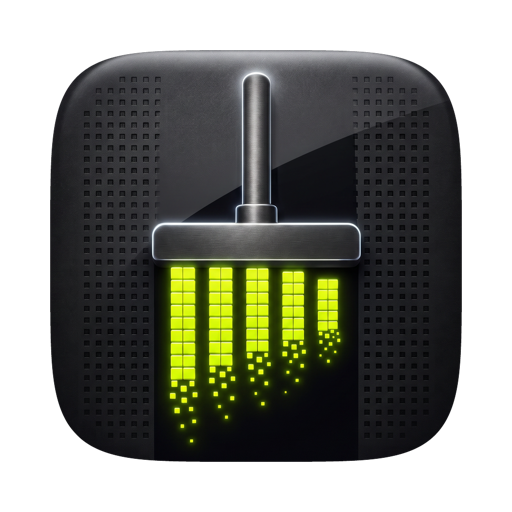

<p align="center"></p>

# Gigamop for Homebrew

```sh
brew install gigamop/tap/gigamop
```

Installs [Gigamop](https://gigamop.com), the Mac app that finds the disk space AI-assisted coding leaves behind. It's the same notarized download as [gigamop.com/download](https://gigamop.com/download). Needs macOS 15 or later.

- Update: `brew upgrade gigamop`
- Remove: `brew uninstall gigamop` (add `--zap` to also remove its settings and clean history)

The cask is updated with each Gigamop release.
